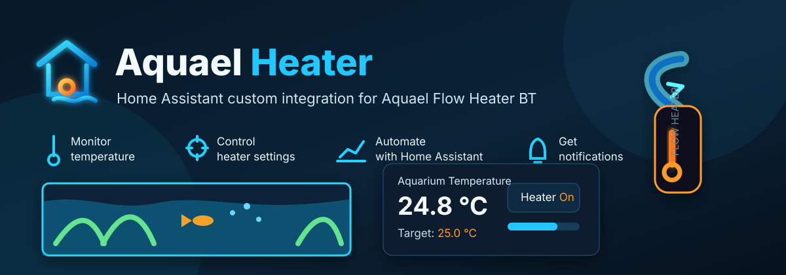

# Aquael Heater



Home Assistant custom integration for the **Aquael Flow Heater BT** using Home Assistant Bluetooth and ESPHome Bluetooth Proxy.

> Version 0.1.x is an early release based on community testing and reverse engineered BLE/GATT characteristics. It has been tested with one Aquael Flow Heater BT.

## Features

- Bluetooth discovery for `Flow Heater BT`
- Manual setup by discovered device or BLE address
- Climate entity for on/off and target temperature
- Mode select entity (`fixed` / `day_night`)
- Night temperature number entity
- Sunrise and sunset time entities
- Configurable polling interval
- Raw temperature diagnostic sensor, disabled by default
- Configuration entities for maximum power, temperature calibration, and transition duration

## Requirements

- Home Assistant with Bluetooth support
- A connectable Bluetooth adapter or ESPHome Bluetooth Proxy with active connections enabled
- Aquael Flow Heater BT

Recommended ESPHome Bluetooth Proxy configuration:

```yaml
esp32_ble_tracker:

bluetooth_proxy:
  active: true
```

Shelly Bluetooth proxies may expose advertisements but are not expected to support the active GATT read/write workflow required by this integration.

## Installation

### HACS custom repository

1. Open HACS.
2. Add this repository as a custom repository.
3. Category: Integration.
4. Install **Aquael Heater**.
5. Restart Home Assistant.

### Manual installation

Copy `custom_components/aquael_heater` into your Home Assistant `custom_components` directory and restart Home Assistant.

## Setup

Home Assistant should discover the heater when it sees a connectable BLE advertisement named `Flow Heater BT`.

You can also add the integration manually. The setup flow scans for discovered heaters and also offers manual BLE address entry as a fallback.

Bluetooth discovery only presents the heater for confirmation. It does not silently create a config entry without user interaction.

## Options

The polling interval can be changed from the integration options:

```text
Settings → Devices & services → Aquael Heater → Configure
```

Default: `30 s`
Minimum: `15 s`
Maximum: `300 s`

## Entities

Enabled by default:

- `climate` - Aquael Flow Heater BT
- `select` - Mode
- `number` - Night temperature
- `time` - Sunrise
- `time` - Sunset

Configuration entities:

- `number` - Maximum power
- `number` - Temperature calibration
- `number` - Transition duration

Disabled by default:

- `sensor` - Raw temperature

## Important notes

The heater is controlled through active BLE/GATT read and write operations. Avoid using the official mobile app at the same time as this integration, because the heater may only accept one active BLE connection.

The integration has currently only been tested with one Aquael Flow Heater BT. Multiple heaters should work in principle because entries are keyed by BLE address, but this is not yet tested.

## Status

Current 0.1.x status:

- HACS custom repository installation: tested
- Bluetooth discovery: tested
- Manual setup: tested
- Read over ESPHome Bluetooth Proxy: tested
- Write over ESPHome Bluetooth Proxy: tested
- Climate entity: tested
- Day/night control entities: tested visually, further runtime testing welcome

## Disclaimer

This project is not affiliated with AQUAEL. The protocol details are based on community testing and reverse engineering.
